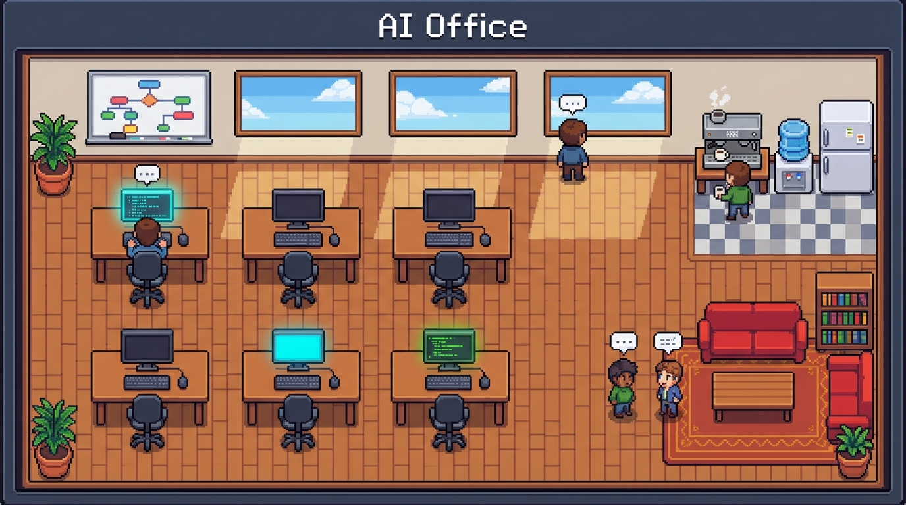

# AI Office



Interface web local em Pixel Art 2D Top-Down que representa agentes de IA locais (CLIs) como personagens em um escritório vivo, detectando processos abertos no terminal e permitindo enviar tarefas pela interface.

## Como rodar

Pré-requisitos: Node.js 22+ e npm.

```bash
cd ai-office
npm install
npm run dev
```

Isso inicia os dois processos em paralelo:
- Frontend (Vite): `http://localhost:5173`
- Backend (Express + WebSocket): `http://localhost:3001`

Para validar a tipagem e gerar o build de produção:

```bash
npm run build
```

Ao abrir `http://localhost:5173`, o escritório carrega automaticamente os CLIs de agentes já abertos no terminal (`claude`, `agy`, `gemini`, `codex`, `aider`). Também é possível adicionar outros agentes manualmente pelo botão **+ Novo** na barra lateral.

## Estrutura

```text
ai-office/
├── docs/
│   └── office-preview.jpg       # Imagem ilustrativa do escritório
├── server/
│   ├── index.ts                 # Servidor HTTP/WebSocket, estado dos agentes e endpoint /api/hook
│   ├── terminalWatcher.ts       # Varredura de processos locais (ps e /proc/<pid>/cwd)
│   ├── cliRegistry.ts           # Detecção de CLIs instalados e montagem de comandos
│   ├── agentRunner.ts           # Execução de tarefas via spawn com streaming e modo simulação
│   └── types.ts                 # Tipos compartilhados entre backend e frontend
├── src/
│   ├── engine/
│   │   ├── officeMap.ts         # Grid 24x15, mesas, móveis e pontos de interesse (café, água, janela, chat)
│   │   ├── pathfinding.ts       # Algoritmo A* para desviar de paredes e móveis
│   │   ├── lifeSimulation.ts    # Máquina de estados de rotina ociosa e transições para trabalho
│   │   ├── pixelSprites.ts      # Renderização procedural em HTML5 Canvas (cenário, móveis, personagens e balões)
│   │   └── OfficeCanvas.tsx     # Loop requestAnimationFrame, hit-test de clique/hover e controles de simulação
│   ├── components/
│   │   ├── TopBar.tsx           # Workspace padrão, CLIs detectados, pausa/velocidade e status WebSocket
│   │   ├── Sidebar.tsx          # Lista de agentes (selo TTY/PID), status ao vivo e provedores locais
│   │   ├── AgentDrawer.tsx      # Painel lateral de chat, saída em streaming e botão para abortar tarefa
│   │   └── AddAgentModal.tsx    # Modal para criar ou editar agente (CLI, comando customizado, workspace e aparência)
│   ├── hooks/
│   │   └── useOfficeSocket.ts   # Cliente WebSocket com reconexão automática e sincronização de estado
│   ├── types/
│   │   └── office.ts            # Tipos do motor de simulação e reexportação dos tipos do servidor
│   ├── App.tsx                  # Layout principal conectando socket, canvas, sidebar e drawer
│   └── index.css                # Estilos da interface
├── package.json                 # Scripts dev, build e dependências
└── vite.config.ts               # Proxy de /api e /ws para o backend na porta 3001
```

## Como funciona

### Backend (`server/`)
- **Detecção de CLIs (`cliRegistry.ts`)**: procura executáveis (`claude`, `gemini`, `codex`, `agy`, `aider`) em diretórios padrão (`~/.local/bin`, `~/.npm-global/bin`, `~/.bun/bin`, `/usr/local/bin`, `/usr/bin`) e via `which`. Inclui também os provedores `custom` (comando livre com `{prompt}`) e `demo` (simulação local).
- **Monitoramento de terminal (`terminalWatcher.ts`)**: executa `ps -eo pid=,ppid=,pcpu=,comm=,args=` a cada 1,5s, ignora PIDs iniciados pelo próprio `AgentRunner` e lê `/proc/<pid>/cwd` para descobrir o projeto atual. Se o processo usar CPU >= 2.2% ou tiver subprocesso ativo (ex.: `bash`, `git`, `npm`), marca o agente como `working` com cooldown de 4,5s; caso contrário, marca como `idle`.
- **Execução pela interface (`agentRunner.ts`)**: ao receber `run_task` via WebSocket, spawna o CLI configurado no `cwd` do agente e envia `stdout`/`stderr` em streaming (`message_chunk`), inferindo a atividade exibida no balão por palavras-chave na saída. Se o CLI escolhido não estiver instalado, cai para o modo simulação.
- **Webhooks opcionais (`server/index.ts`)**: o endpoint `POST /api/hook` aceita eventos JSON (`provider`, `pid`, `event`, `tool`, `detail`) para sobrescrever temporariamente o status e o texto de atividade de um agente de terminal. Agentes criados manualmente são persistidos em `office-config.json`.

### Frontend (`src/`)
- **Mapa e movimentação (`officeMap.ts`, `pathfinding.ts`)**: define um grid de `24x15` tiles de `32px` com 6 mesas (`DESK_SLOTS`), móveis sólidos e pontos de interesse (`POINTS_OF_INTEREST`). O `findPath` calcula rotas A* evitando células bloqueadas.
- **Rotina ociosa (`lifeSimulation.ts`)**: enquanto `status !== 'working'`, cada personagem escolhe periodicamente uma ação ociosa: pegar café, beber água, olhar pela janela, ver o quadro branco, descansar no sofá, cuidar de uma planta ou convidar outro agente livre para conversar com diálogos alternados. Quando `status === 'working'`, o personagem cancela a pausa e caminha até sua mesa.
- **Renderização (`pixelSprites.ts`, `OfficeCanvas.tsx`)**: desenha piso, janelas com nuvens em movimento, móveis ordenados por profundidade em Y, personagens com animação de caminhada/digitação e balões de fala diretamente em Canvas 2D com `imageSmoothingEnabled = false`.
